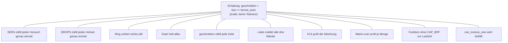

# Stern statt Liste: Erhaltungsgleichung in der Mitte

Nicht linear abgearbeitet, sondern als Abhängigkeitsstern: Die Mitte gilt
nur, wenn alle Speichen tragen. Status je Speiche: **belegt** (mit Quelle)
oder **offen** (mit dem einen Experiment, das sie entscheiden würde).

## Speichen

| Speiche | Status | Beleg / offenes Experiment |
|---|---|---|
| SEEN zählt 1× | **belegt** | Pfad-Review (ein `count_seen` im Wrapper); `over_nobpf`-Gleichung exakt |
| DROPS zählt 1× | **belegt** | Doppelzähl-Fix; Verhältnis 1.000 in allen Läufen seitdem |
| Ring still verlustfrei | **belegt** + Annahme | aya-Audit: Discard = gezählt, Busy = transient; Kernel-Seite Annahme |
| Drain holt alles | **belegt** | Kein consume-then-drop mehr (Fix); Konvergenz; Lauf 7 grün |
| geschrieben zählt | **belegt** | Code + Host-Tests; Zähler nur nach erfolgreichem Emit |
| --stats meldet | **belegt** | K13-Parse + Läufe zeigen alle drei Zahlen |
| K13 prüft | **belegt** | Smoke-Test + Root-Läufe |
| Matrix-over | **belegt** | 7 Läufe, alle Mengen |
| ohne CAP_BPF | **belegt** | `over_nobpf`: null Caps, volle Funktion, exakt |
| exe_ino/exe_size | **offen (Laufzeit)** | Code-Seite belegt; Sensorfüllung erst durch Phase H (K23/K24) |

## Regel zum Stern

Falsifizierbarkeit vor Vollständigkeit gilt pro Speiche: Jede Speiche braucht
ihren eigenen Diskriminator (nicht: „passt zum Gesamtbild“). Eine neue
Beobachtung bricht genau die Speiche, die sie betrifft — der Rest des Sterns
bleibt stehen.
